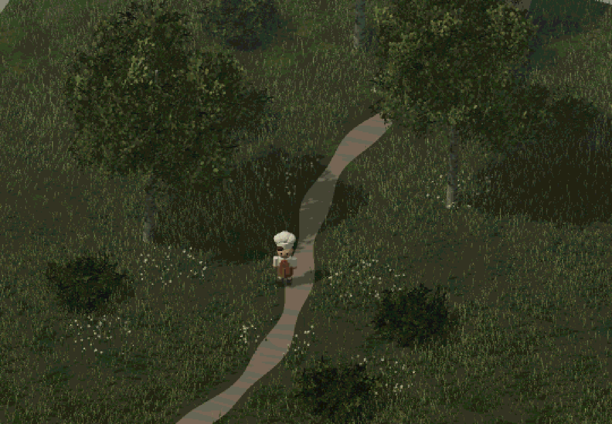
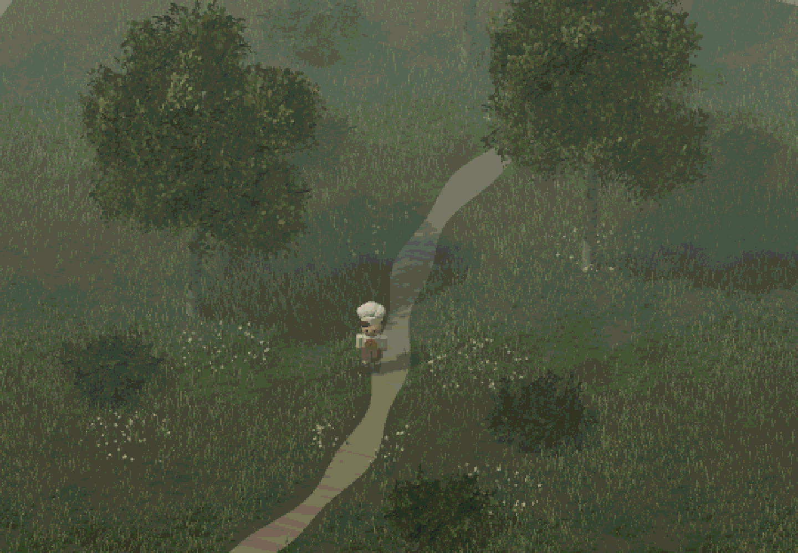
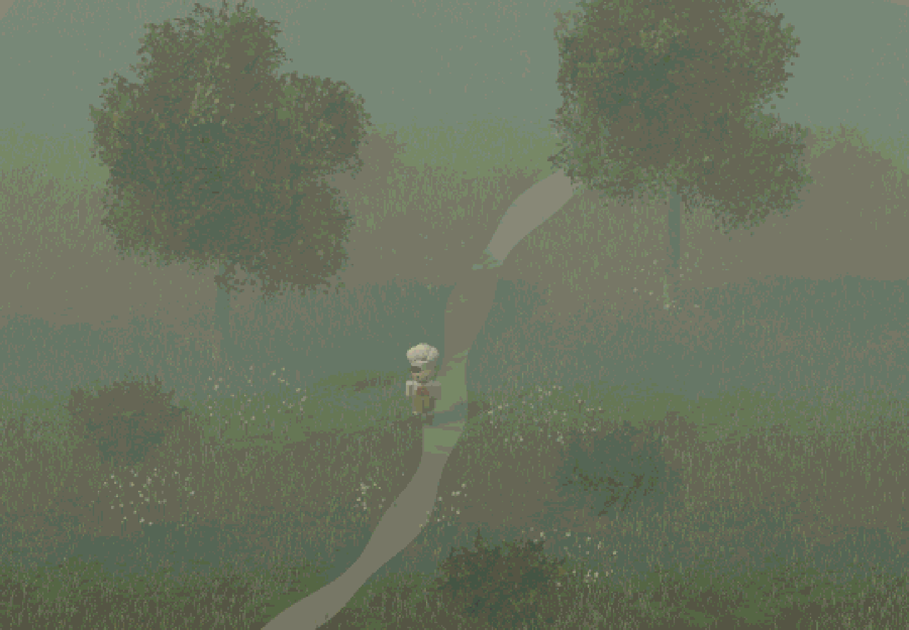

# V1.2 实景验证报告

本轮仅新增 `/atmospheric.html`，没有将视觉系统应用到正式庭院，也没有扩建或增加游戏玩法。日期：2026-10-29（Asia/Shanghai）。所有图片来自 Chromium 中真实 Three.js WebGL2 渲染；没有使用生成图片、静态背景或预渲染视频代替场景。

## 同镜头对比

固定种子 1207，1440 × 1000 CSS px，DPR 1，相机位置 `[10,20,22]`，正交视口高 18 单位。三档雾均固定草地/树叶/角色、冻结风与待机、相同光照与色彩，未分别调曝光。默认选择中雾：比初始 0.027 更能保留近景草叶与厨师对比度。

| 轻雾 0.008 | 中雾 0.018（默认） | 浓雾 0.031 |
| --- | --- | --- |
|  |  |  |

[关闭像素化的原始 3D 对照](unpixelated.png)：同一中雾、相机、照明和饱和度，恢复全 CSS 分辨率，绕过 RetroPass 像素化和量化。保留色调映射，便于比较物体质量。

[调试面板](panel.png) · [390 × 844 触屏布局](mobile.png) · [完整参数及原始测量数据](measurements.json)

## 画面与技术结果

- 地面为连续起伏网格，搭配程序纹理及覆盖度变化，非纯色地坪；55,656 根三段草叶，细碎轮廓与缓慢世界空间风。
- 三棵分枝树使用实例叶片卡和程序 alpha 纹理，六组低矮灌木，无球形树冠；共 6,120 张叶簇卡。三种深度位置形成近景/中景/远景。
- 658 朵白色小花按九个聚集区域布置，不是全场均匀随机。
- 复用原厨师模型/动画，克隆预览材质与几何体，避免改变原庭院共享材质。角色比初版明亮沙盘更收敛，但白帽、白衣、围裙仍可辨识。
- FogExp2 对草叶、地面、叶片、树干、角色生效；雾色与背景一致。当前是距离雾，不是体积光、局部雾团或高度雾。
- RetroPass 1.3.0 复用像素格采样与立方颜色量化，4096 色上限，无 dithering/bloom/黑描边。饱和度 0.78，内部 1080 × 750，像素格 540 × 375，再映射到 1440 × 1000；关闭像素化时内部恢复 1440 × 1000。
- 三档雾和无像素图相机数组完全一致。暂停风/待机后，同参数重复截图 PNG 字节完全一致（`staticFrameIdentical: true`），排除静态随机闪烁。拖动镜头及像素格变化经过浏览器操作检查；运动中的草叶本身会变化，真实设备上的细叶闪烁仍需继续观察。

## 实测与局限

运行环境是 Linux Chromium + **ANGLE Vulkan SwiftShader 软件 GPU**，未暴露 `/dev/dri`。因此不能把它当作常见桌面独显或手机帧率的验收。

| 测项 | 结果 |
| --- | --- |
| 主入口 TypeScript 类型检查 | 通过 |
| 双 HTML 入口生产构建 | 通过 |
| 原有碰撞和角色动画测试 | 5/5 通过 |
| 原庭院键盘行走/Shift 跑步/停止/帮助框/触屏摇杆 | 浏览器回归通过，无页面错误 |
| 美术面板预设、Pixel Size、Render Scale、密度重建、像素开关、重置 | 浏览器断言通过 |
| 固定像素图重复性 | 字节一致 |
| 相机拖动、390 × 844 手机布局 | 通过；触屏初始收起调试面板 |
| 页面/着色器 console error | 最终测试 0 条 |
| 当前默认场景绘制 | 稳态约 42 draw calls，315,545 三角形（含后处理，不含已缓存的阴影首帧） |
| 60 帧 rAF 采样，前 5 帧排除 | 平均 **1.10 FPS**，中位 **866.6 ms**，P95 **1766.5 ms** |

性能数值为本次软件渲染实测，**当前云端不能流畅运行此预览**；真实硬件的性能尚未得到证明。默认约 31.6 万三角形、alpha 叶片 overdraw、逐草叶阴影采样对软件 rasterizer 成本较高。不能只依据 42 draw calls 宣称高性能。`measurements.json` 的各 preset 初期 metrics 可能是尚未满 20 帧的占位或上一个窗口值；正式帧时间结论使用其独立 `frames` rAF 样本，不使用初期 FPS 字段。面板显示平均 rAF 帧率和 CPU 提交时间，后者不是 GPU timer。

当前措施：植被实例化、树干合并、有限像素缓冲、单灯 1024 阴影、静态阴影缓存、共享纹理和材质。草叶不投射阴影，但接收树木阴影；厨师只做微幅待机，因此预览中缓存阴影的轻微不同步可接受。正式移动场景需要重设阴影更新策略。

可在面板降低 Grass Density 与 Render Scale 以比较成本；尚未用真实 GPU 量化这些档位。静态对照图的无像素版细节更多，像素版保留有限色阶会产生一定带状色阶，属于当前复古方案的局限。没有声称与参考图完全一致。

## 复用与许可

实际使用 RetroPass（BSD-2-Clause）和 three-stylized 六个草叶模块（MIT），保留源码与构建产物中的版权许可。Three.js 官方工具 MIT。原生分枝、叶簇卡和 Canvas 贴图由本项目生成。其余推荐仓库已评估但未安装或复制，具体版本/提交/文件/适配见 [REFERENCES.md](../../REFERENCES.md)。

开发入口运行：`npm run dev`，打开 `/atmospheric.html`。复现截图和测量：`node tests/art-browser.mjs`；快速控件与移动布局检查：`node tests/art-controls.mjs`。脚本自动化使用 SwiftShader 以保证本环境可运行，结果不可外推真实 GPU。

## 正式庭院重构前的建议

先确认本轮像素颗粒、配色与中雾方向，并在真实桌面 GPU / 手机测量同一场景；在确认前保持原庭院入口不变。随后按约 1.7～2 倍可玩面积规划庭院，把浓密植被放在外围，保留中央追逐路线和锅/门框的可读性。应先把草叶按区块划分、距离裁剪并提供密度档位，远景树采用 billboard/LOD，控制 alpha overdraw，再决定是否需要高度雾。角色移动时单独验证像素对齐与阴影更新，不能直接沿用本预览的静态阴影策略。

美术验证阶段停在独立场景。后续按用户指示增加 GitHub Pages 部署；方法见 README，网站状态以部署回执为准。
