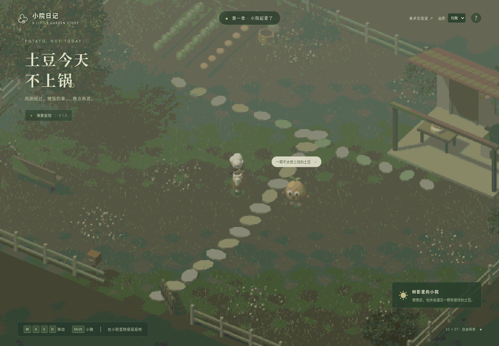

# V1.3 薄雾像素庭院推广与扩建

2026-10-29（Asia/Shanghai）。在用户确认 V1.2 方向可行后，将验证过的像素、植被、薄雾系统应用到正式探索入口，并扩建庭院。本轮不增加 AI、抓捕或计时玩法。

## 实景

[无 HUD 庭院](overview.png) · [厨房与锅](kitchen.png) · [菜园](garden.png) · [手机轻量档](mobile.png)

图片均为 Chromium 实时 WebGL 截图，无生成图片或预渲染背景。

## 完成内容

- 地表由 24 × 20 扩至 **32 × 27**，面积 **1.8 倍**。实际角色边界从 ±11.4 / ±9.4 扩至 ±15.2 / ±12.7，同步更新围栏与入口位置。
- 厨房移至 `(8,-8)`，菜床移至左后侧，秋千/长凳移至左侧，三棵分枝树和灌木主要位于外围；保留厨房、菜园及中央环跑路线。
- 原生 FogExp2 0.018、灰绿背景、柔和暖太阳与环境光、RetroPass 像素量化、饱和度 0.78。正式场景使用平地，草叶覆盖避让厨房、菜床和主通路；中央更短更疏，外围更丰富。
- 厨师、土豆和基础动画保留；移除旧描边及明显 flat shading，平滑表面法线；调整正式场景脚底高度；土豆斑点改为一个 InstancedMesh。
- 斜俯视镜头改为正交全程跟随，并进行屏幕平面像素网格对齐。手机仍以玩家为中心，不会因扩大世界而把玩家留在画面外。
- 三档画质即时切换：同时调整草叶密度、段数、树叶卡数和渲染比例，不重置位置；切换时释放被替换的 GPU 缓冲、纹理与材质。
- 太阳的 1024 阴影只缓存静态环境，移动角色使用跟随位置的程序柔和接触阴影；画质变化后重绘环境阴影。牺牲了角色精确的方向长阴影，不再逐帧重画所有植被阴影。
- `/atmospheric.html` 继续保留为独立美术实验室。Pages 的两页入口与相对资源路径保留。

## 实测

数据来自 [measurements.json](measurements.json)。1440 × 1000、DPR 1、相同出生点/镜头，仅切换画质；以下计数是首帧缓存阴影结束后的稳态值，未计首帧阴影峰值。

| 画质 | 草叶 | 叶簇卡 | 三角形 | Draw Calls | Render Scale / Pixel Size |
| --- | ---: | ---: | ---: | ---: | --- |
| 轻量 | 4,511 | 2,220 | 52,264 | 94 | 0.5 / 1 |
| 均衡 | 9,022 | 3,060 | 67,477 | 94 | 0.75 / 2 |
| 细腻 | 14,178 | 4,140 | 113,461 | 94 | 1.0 / 2 |

触屏默认轻量、桌面默认均衡。手机 Pixel Size=1 配合 0.5 比例，实际为 2 CSS px 颗粒，兼顾角色辨识。V1.2 的独立验证场景有约 31.6 万三角形；本轮正式场景的均衡档几何成本明显降低，但不是同一场景，不以此直接推断 FPS 倍率。

**软件渲染实测**：ANGLE Vulkan SwiftShader，出生点 `(-0.5,2)`、均衡档，单个活跃渲染标签，排除前 5 个样本后采样 30 帧，平均 **2.67 FPS**，中位帧间隔 **366.6 ms**，P95 **683.3 ms**。当前云端仍不流畅；这不是实际显卡/手机结果。真实设备的帧率、Safari/Firefox 兼容性尚未验证，未宣称达到 60 FPS。

## 验证结果

- TypeScript 类型检查、双入口生产构建通过。
- **9/9** 测试通过：角色动画/眨眼、原碰撞行为、新边界、实际布局厨房/菜园/连续环跑通路、植被掩膜、桌面/竖屏远端玩家可见性。
- 实际键盘行走、Shift 奔跑、停止回待机、帮助框暂停、触屏摇杆通过。
- 三档画质的草叶/叶片数量断言通过；出生位置保持不变。
- 浏览器在右侧边界移动时被挡住并可沿边滑动；分步碰撞允许距理论边界小于一个 0.12 单位子步的提前停止，测试检查正确的范围而非某个精确浮点坐标。
- 新场景、画质切换、手机布局最终控制台错误 **0 条**。
- GitHub Pages 子路径生产烟测覆盖两页、资源请求、实验室往返链接、键盘画质选择；生产不暴露调试传送接口。具体执行结果与部署提交见交付回执。

## 限制与后续

本轮仍是自由探索，土豆只待机；没有抓取、逃跑 AI、计时或随机事件。高树冠可能在经过时遮挡部分场景，未实现树冠自动淡出；厨房前半屋顶继续开放以保证锅可见。草叶与花朵不阻挡，碰撞为简化 AABB，秋千/菜篮/锅尚不可互动。树木没有动态 LOD，草叶还没有区块裁剪或自适应质量。

下一阶段应先收集上线后的真实设备反馈，再确定草叶区块化与 LOD 的必要性；随后明确土豆基础逃跑和抓取的规则，再实现玩法，不把尚未确定的第二轮/怨气/随机事件提前加入。
